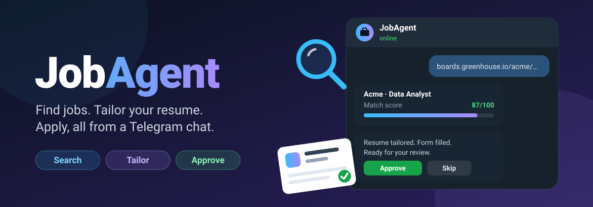

<p align="center"></p>

# JobAgent

**Your own job-application assistant, controlled from Telegram.** It finds jobs that fit you, tailors your resume for each one, fills in the application, and shows you everything before anything is sent.

- 🔒 Runs on **your computer**, with **your own Claude subscription**. Nothing is hosted; your data stays in the `data` folder.
- ✋ **Nothing is sent without you.** Practice mode is on until you turn it off, and every application waits for your Approve.
- 👀 **You always know what it is doing.** Each job gets a live card in the chat that shows the step it is on, in plain words.

---

## What you need

- A computer that stays on while JobAgent works (Windows, macOS or Linux)
- A **Claude Pro or Max** subscription
- **Telegram** on your phone
- About 10 minutes

Everything else (Claude Code, uv, Bun and the form-filling browser) the setup installs for you.

## Set it up

1. **Download JobAgent.** `git clone https://github.com/20xAEsec/job-agent-telegram.git` (or on GitHub click **Code → Download ZIP** and unzip it).
2. **Run the setup** in that folder:
   - **Windows:** right-click `scripts\setup.ps1` → *Run with PowerShell*, or in a terminal:
     `powershell -ExecutionPolicy Bypass -File scripts\setup.ps1`
   - **Mac / Linux:** `scripts/setup.sh`
3. **Follow the five steps it shows you.** It checks your computer, installs what is missing, has you log in to Claude, and helps you create your Telegram bot with @BotFather (one minute; it tells you exactly what to tap).
4. **Scan the QR code** it shows with your phone camera (or open the link), and tap **Start** in Telegram. That connects the bot to you, and only you.
5. **Answer the setup questions in Telegram.** Send your resume, pick the roles you want, location and pay, and a few eligibility questions. About 3 minutes; every answer can be changed later.

Prefer to be guided? Open a terminal in the folder, run `claude`, and say **"set this up"**. Claude installs what is missing (including Telegram Desktop), opens BotFather and the setup window for you, and tells you when your phone is connected.

## Start it (next time)

- **Windows:** `scripts\start.ps1`
- **Mac / Linux:** `scripts/start.sh`

Keep that window open (minimizing is fine). Closing it turns JobAgent off. 
On Windows you can instead run it in the background (starts at login, no window, restarts if it crashes): `scripts\background.ps1` (turn off with `-Remove`, check with `-Status`).
Add `-Practice` (Windows) or `--practice` (Mac/Linux) to lock practice mode on.

## Using it

| You want to… | Do this |
|---|---|
| Apply to a job you found | Send the link in the chat. A live card shows each step: reading, scoring, tailoring, filling in, review. |
| Let it find jobs | Home → **🔭 Turn on Auto-search**. It checks companies you watch and searches LinkedIn and Indeed on a schedule, and can find new companies hiring for your titles. Set **Posted within** to 1 hour (and **How often** to every hour) to see only the newest jobs. |
| See what needs you | Home → **📥 Needs you**: reviews to approve, questions only you can answer, and stuck jobs. |
| Approve an application | The review card shows every answer, what changed on your resume, the cover letter, and pictures of your resume and the filled-in form. Tap **✅ Approve**, **✏️ Edit an answer** (instant, no waiting for Claude), **📄 Original resume**, **💬 Ask for a change** (just say what), **⏭ Skip**, or **🚫 Never this company**. |
| Apply where JobAgent can't fill the form | You get an **application kit**: your tailored resume (and cover letter), drafted answers you tap to copy, and the link. Apply on the site, then tap **✅ I applied** so it is tracked under Jobs → Applied. |
| Choose which messages ring | **⚙️ Settings → 🔔 Notifications**: reviews, auto-search results, follow-up reminders and computer problems can each ring or arrive silently; the weekly summary can also be turned off. Quiet hours silence everything overnight, and typing *"snooze"* silences everything for an hour. |
| Change what it looks for | **⚙️ Settings**. Every setting explains what it does. You can also just tell it: *"raise my minimum salary to 120k"*. |
| Fix a saved answer | **👤 Profile → 💾 Saved answers**. Private ones are hidden behind a tap. |
| Track how it's going | **📋 Jobs**: mark Interview, Offer, Rejected or No reply (Interview and Offer get their own tabs), or export everything to a spreadsheet. **📊 Insights** shows where applications go and what gets replies; a weekly summary arrives on Monday mornings. |
| Get ready for an interview | Mark the job **🗣 Interview**, then tap **🎤 Interview prep**: a company snapshot, likely questions, STAR stories from your own profile, and questions to ask. |
| Follow up | After a week with no news, JobAgent asks how it went and can **✍️ draft a follow-up email** for you to send (it never sends email). Change or turn off the reminder in Settings → How I apply. |
| See everything on one screen | Home → **🖥 Dashboard** gives a link to open on your computer: a pipeline board, score breakdowns, resume changes, insights, and Approve/Skip. It runs only on your computer and never shows private answers. To use it on your phone too, tap **📱 Set up phone access**: you run a free tunnel (Cloudflare Tunnel or Tailscale Funnel), paste its address, and the dashboard opens inside Telegram for your account only (see [docs/dashboard.md](docs/dashboard.md)). |
| Ask quick questions | Type *"what's waiting?"*, *"status"*, *"show my jobs"*, *"pause"* or *"snooze"* for an instant answer (no Claude needed). Anything else goes to Claude. |
| Pause or stop | **⏸ Pause** on Home finishes the current step, then waits. **✋ Stop** on a card stops that job. `/stop` stops everything. |

**Practice mode** (on by default): JobAgent does every step except pressing Submit, so you can see exactly what it would send.  
Turn it off in **Settings → Practice mode** when you're ready; you still approve each application.

**Review queue:** after each auto-search you get one summary of what it prepared, best match first, with **🔔 Review all**, instead of a message per job. Each review shows the match broken down (title, level, skills, place, pay), which requirements you meet, and how many of the posting's keywords your resume covers before and after tailoring; tap **✋ I have one of the missing ones** to add a real skill and rework the resume.  
**Learning from you:** after 15 approve/skip decisions, Home may suggest a better minimum match score (one tap to apply), and scoring takes your past choices into account.  
**🩺 Health:** JobAgent checks your computer every few hours (Claude login, browser, disk space…) and shows any problem on Home with the fix. `/health` shows the full list.

**Auto-apply** (off by default, Settings → How I apply): only very strong matches are sent on their own, after a countdown with a Cancel button.  
Unusual forms and private questions always come to you.

### What works today

- Filling in **Greenhouse**, **Lever** and **Ashby** application forms (used by thousands of companies). For a LinkedIn, Indeed or company-page link, JobAgent first looks for the employer's own form on those systems (the "apply on company site" link, or the company's job board matched by title and location) and fills that instead. Links it can't match are still read and scored, and good matches get an application kit (tailored resume, drafted answers, the link) so you can apply yourself in a few minutes.
- Auto-search runs without Claude: JobAgent checks the boards and job sites itself and only uses your Claude limit on jobs that pass your filters. Links you send always go ahead of auto-search work. Set your **Country** (⚙️ Settings → What I look for) so LinkedIn, Indeed and Glassdoor search the right place.
- Auto-search over Greenhouse, Lever and Ashby job boards, LinkedIn and Indeed (Glassdoor and ZipRecruiter can be turned on in ⚙️ Settings → Auto-search → Where I look), via [python-jobspy](https://github.com/speedyapply/JobSpy). These sites have no public API, so searches are kept small; LinkedIn may still limit them for a while if you search very often.
- LinkedIn links are first read from LinkedIn's public job page, so most need no login (Auto-search reads that page for the LinkedIn results that pass your filters). Indeed links are read through Indeed's app API. When a site still insists on a login, the job is read in JobAgent's own browser window, where you log in once (the job's card has a **🔑 Log in** button): ⚙️ Settings → **🔑 Job site logins**. It can't reuse your everyday browser's login (Chrome encrypts its cookies for Chrome alone). **Save password** keeps your login in the computer's password vault (Windows Credential Manager / macOS Keychain) so JobAgent can log back in by itself; it never goes through Telegram. Applying is still done by you on those sites. From a terminal: `uv run --project agent jobagent login linkedin|indeed|status` and `jobagent credentials set|delete linkedin|indeed`.
- Resume tailoring for **PDF** and **Word (.docx)** resumes. For .docx you need Microsoft Word or LibreOffice installed (setup tells you).

## Privacy and safety

- Your profile, saved answers, resume and job history live in `data/` on your computer. Delete that folder to erase everything.
- The thinking runs on your own Claude account. Telegram bot chats are not end-to-end encrypted, so private answers (salary, work authorization, diversity questions) are hidden behind a tap and never guessed.
- Job postings are treated as untrusted text and are read by a separate, sandboxed reader, so a posting can never give JobAgent instructions.
- Only the app can submit, only after you approve, and the approval is tied to the exact answers and files you saw. If anything changes, it asks again.
- It never solves CAPTCHAs or creates accounts. Jobs that need that come to you.

## Troubleshooting

- **The bot doesn't answer:** is the JobAgent window still open, and is the computer awake?
- **"Usage limit reached":** that's your Claude plan's limit. JobAgent waits and continues by itself; the card says when.
- **"Claude needs you on your computer":** open a terminal, run `claude`, and log in again.
- **A job says "Needs you":** it hit a login, a CAPTCHA or an odd page. Open it from **📋 Jobs** and tap **Try again**, or apply by hand.
- **"JobAgent is already running":** only one copy can use your bot. Close the other window.
- **Connect a different Telegram account:** run `uv run --project agent jobagent pair --reset`, then the setup again.

Logs are in `data/logs/app.log` (the app) and `data/logs/agent.log` (why a `jobagent` command failed). They record what happened and where, not your answers or posting text.

### Let Claude fix a problem (optional)

When something fails, the card shows **🔧 Let Claude look into this** (or send `/fix`). Your own Claude reads the logs, finds the bug, fixes it in a separate copy of the code, runs the tests, and shows you the fix in Telegram. **Only if you tap ✅ Open the pull request** is it shared: it opens a pull request on this repo from your GitHub account. Your own copy is never changed; you get the fix when it is merged and you `git pull`.

You need: JobAgent installed with `git clone` (not the ZIP), the [GitHub CLI](https://cli.github.com) installed, and `gh auth login` done once. If one is missing, it tells you.

What is kept out: the log copy Claude reads has emails, tokens and your profile details removed, and a fix is refused if it still contains any. A fix can't change the safety rules, the approve-and-submit gate, pairing, setup scripts or dependency lists, and it is limited to 10 files and 400 lines. A fix that does not pass the tests is never offered.

---

## For developers

```
app/      Bun + TypeScript: the Telegram bot, screens, live cards, setup wizard, review gate, and the Claude task runner
agent/    Python (uv): job store, Greenhouse / Lever / Ashby adapters, resume tailoring, form filling (Playwright), discovery, the submit choke point
.claude/  Claude's skills, the sandboxed job-analyst subagent, and the permission rules for headless tasks
```

- The app runs each piece of work as a headless `claude -p` task (`app/src/agent.ts`) with `--output-format stream-json`. Every tool call streams back and becomes the plain-words line on the live card (`app/src/activity.ts`). Usage-limit events re-queue the task until the limit resets. The queue lives in `data/tasks.json` and survives restarts.
- Claude reaches the app through a small MCP shim (`app/src/mcp.ts`), which forwards tool calls to a localhost-only endpoint that has a per-run secret (`app/src/bridge.ts`). Tool rules are enforced in code; for example, settings can only change from chat, and practice mode can never be turned off by Claude.
- Permissions: tasks run with `--setting-sources project --settings .claude/settings.json --permission-prompts none`. Anything outside the allow list is denied automatically, so nobody is ever asked to approve a permission.
- Only `app/src/review.ts` writes `approval.json` and runs `jobagent submit`. `jobagent submit` refuses unless the approval hash matches the plan and files on disk.

Tests:

```
cd app && bun test                 # app: screens, forms, task runner, bridge, review gate, setup wizard
uv run --project agent pytest      # Python: store, ATS adapters, tailoring, safety, discovery
uv run --project agent jobagent canary [--live <posting url>]   # dry-fill every adapter against its recorded form; --live also reads one real form (types nothing)
```

- Adapters live in `agent/jobagent/ats/`. Greenhouse reads its form from the public API; Lever and Ashby have no form API, so `ats/formscan.py` scans the rendered form into the same `fields.json` rows. Every adapter checks for CAPTCHAs and logins (the job goes to "Needs you"), never presses Enter, and only `safety.click_submit` clicks Submit. The Lever and Ashby fixtures in `agent/tests/fixtures` were built from those sites' public markup, not recorded byte for byte, and their submit and confirmation path is not verified live: run `jobagent canary --live <url>` against a real posting after a site redesign.
- `jobagent resolve <job_id>` upgrades a job-site or company-page listing to the employer's fillable posting (it keeps the job id and stores `resolved_from` in `meta.json`).
